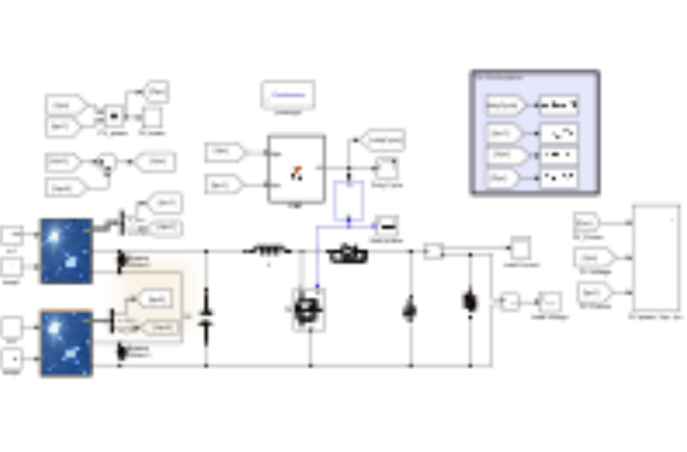

# MPPT method based on perturbation observation algorithm for photovoltaic applications under partial shading conditions (Simulation in Simulink)

The MPPT method based on P&O is applied in photovoltaic applications under PSC, and the MPPT method based on disturbance observation algorithm is used for partial shading conditions. This report introduces a traditional MPPT method based on P&O technology to reduce the impact of partial shading on system efficiency. We will present the results of the P&O algorithm under partial shading conditions. Two 1Soltech modules are connected in series, and a DC-DC boost converter is used as the boost stage between the source and load to control the working voltage. One module will be partially shaded, with an irradiance intensity of 500 W/m², while the other is under normal conditions, both at 25°C.

## Images

<!-- PAYMENT_BLOCK -->

## Get this dataset

- Payment link (Stripe): [Buy now](https://buy.stripe.com/3cs8yP7sY87d0vu9AB)
- Payment QR code: 

<!-- /PAYMENT_BLOCK -->
